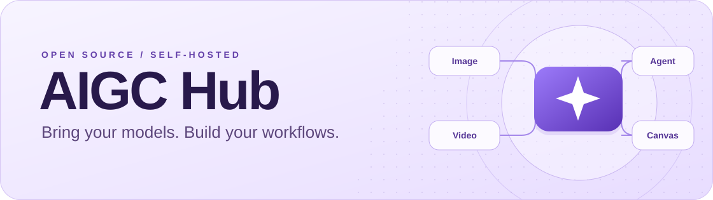
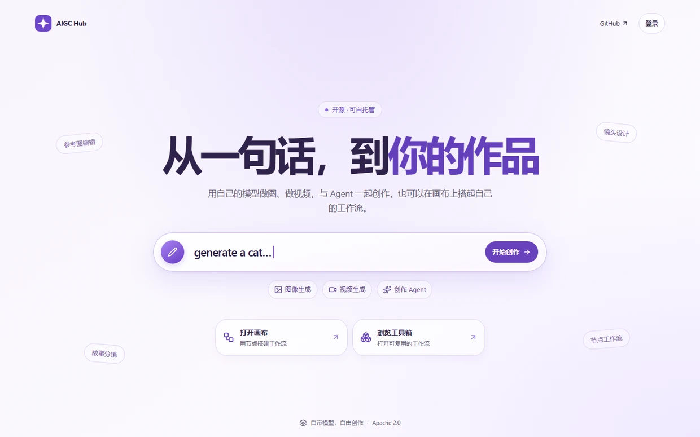
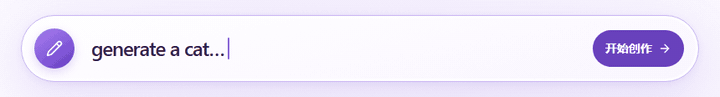

<p align="center">
  
</p>

<p align="center">
  <a href="https://github.com/makur6371/aigc-hub/actions/workflows/verify.yml"></a>
  <a href="LICENSE"></a>
  <a href="docs/deploy.md"></a>
</p>

# AIGC Hub

**Bring your own models to a self-hosted AI creation workspace.** Create and edit images, generate video, chat with an agent, and build reusable node workflows. The default installation has no configured model providers.

[简体中文](README.md) · [Deployment guide (中文)](docs/deploy.md) · [Contributing (中文)](CONTRIBUTING.md)

- **Create:** prompt-to-image, reference image editing, and video generation. Video settings follow the selected model's capabilities.
- **Agent:** streaming chat and configurable task planning.
- **Canvas and tools:** connect nodes, run workflows, and save, import, or export them.
- **Results and administration:** track jobs, recover results, manage assets, configure models and quotas, and inspect usage.

## Homepage preview



<details>
<summary>View the typing animation</summary>



The creation bar cycles through example prompts and opens the workspace when selected.

</details>

## Run the local demo

Install Node.js 24 and npm, then run:

```sh
git clone https://github.com/makur6371/aigc-hub.git
cd aigc-hub
npm ci
```

Copy `.env.example` to `.env`. Set `JWT_SECRET` to a random value at least 32 characters long, provide `BOOTSTRAP_EMAIL` and `BOOTSTRAP_PASSWORD` (at least 12 characters and at most 72 bytes), and set `APP_ENABLE_DEMO=1`.

```sh
npm run db:setup -- --demo
npm run dev
```

Open [the workspace](http://localhost:3000), sign in, and select a local demo model in Create. The demo uses bundled sample media and text; it needs no API key.

For a real installation, run `npm run db:setup` without `--demo` and configure your providers in System Settings. Use [Docker Compose](docs/deploy.md) for a persistent installation. The current app expects persistent SQLite and file storage and is not a one-click Vercel deployment.

## License and attribution

[Apache License 2.0](LICENSE). Keep the applicable [NOTICE](NOTICE) when redistributing. Third-party dependencies retain their own licenses. A link back to AIGC Hub in your site's About page is welcome.

Report vulnerabilities privately following the [security policy](SECURITY.md).
