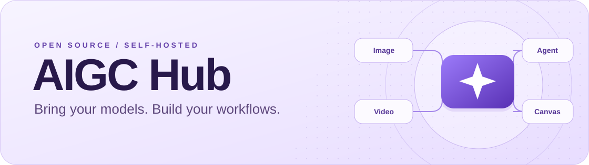
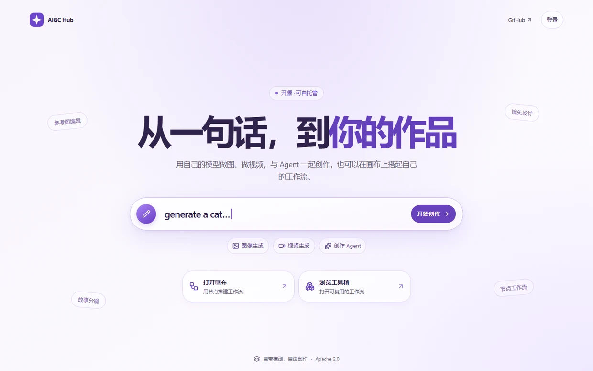
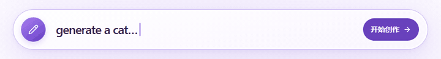
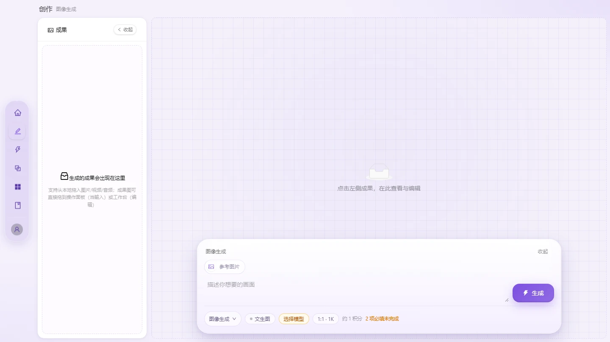
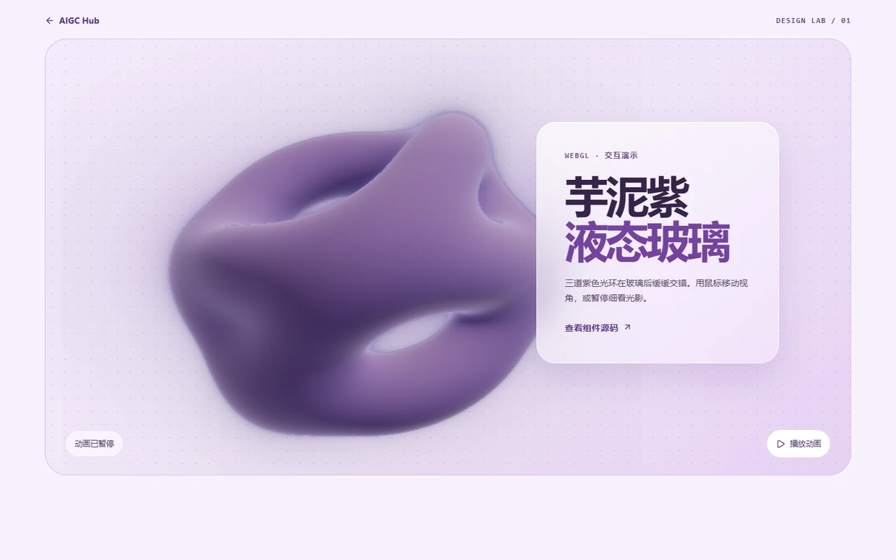

<p align="center">
  
</p>

<p align="center">
  <a href="https://github.com/makur6371/aigc-hub/actions/workflows/verify.yml"></a>
  <a href="LICENSE"></a>
  <a href="docs/deploy.md"></a>
</p>

# AIGC Hub

**用自己的模型，搭一个 AI 创作工作台。** AIGC Hub 把图像生成与编辑、视频、Agent 和节点画布放在同一个地方。项目默认没有供应商账号或模型，个人和团队可以按需接入自己的服务。

**界面特色：芋泥紫 × 液态玻璃。**

[English](README.en.md) · [部署指南](docs/deploy.md) · [参与贡献](CONTRIBUTING.md)

| 工作区 | 可以做什么 |
| --- | --- |
| **创作** | 文生图、参考图编辑、视频生成；视频参数和素材入口随模型能力变化。 |
| **Agent** | 对话、流式回复，按配置规划和执行创作任务。 |
| **画布与工具箱** | 用节点和连线搭工作流，保存、导入、导出，或整理为可复用工具。 |
| **成果与管理** | 查看任务进度、恢复成果、管理素材；管理员配置模型、额度和使用记录。 |

## 首页预览

柔和的芋泥紫打底，半透明面板配上细描边、柔光和大圆角。从首页的创作胶囊到工作台底部的操作面板，延续同一套视觉风格。



<details>
<summary>查看创作胶囊的打字动画</summary>



创作胶囊会循环输入并删除示例；点击进入创作工作区。

</details>

### 创作工作台



左侧查看成果，中间预览和编辑，底部切换创作方式、添加参考素材和设置生成参数。

### WebGL 玻璃演示



本地启动后，从首页点「玻璃演示」，或打开 [`/demo/glass`](http://localhost:3000/demo/glass)。无需登录。可暂停动画；设备不支持 WebGL 时会显示静态画面。[查看组件源码](src/components/auth/ShaderBackground.tsx)

## 快速体验

演示无需 API Key。需要 Node.js 24 和 npm。安装依赖并准备配置：

```sh
git clone https://github.com/makur6371/aigc-hub.git
cd aigc-hub
npm ci
```

把 `.env.example` 复制为 `.env`，填好下面四项：

| 配置 | 填什么 |
| --- | --- |
| `JWT_SECRET` | 随机密钥，至少 32 字符。可用 `node -p "require('node:crypto').randomBytes(32).toString('hex')"` 生成。 |
| `BOOTSTRAP_EMAIL` | 初始化管理员使用的邮箱。 |
| `BOOTSTRAP_PASSWORD` | 自己设置的密码，至少 12 个字符，最多 72 字节。 |
| `APP_ENABLE_DEMO` | 设为 `1`，开启本地演示。 |

```sh
npm run db:setup -- --demo
npm run dev
```

打开[本地工作台](http://localhost:3000)并登录。在「创作」里选择「本地演示」模型，可以跑通出图、对话和异步视频任务。演示返回固定的本地样图、短片和文字，方便验证流程。

## 接自己的模型与部署

正式实例用 `npm run db:setup` 初始化。模型默认是空的，在「系统设置 → 供应商与模型」填入自己的接口。文生图走 `/images/generations`；支持 multipart 编辑的接口选「通用图像编辑接口」，参考图走 `/images/edits`。视频的生成方式、比例、分辨率、时长和素材上限由模型配置声明。

完整实例推荐 [Docker Compose](docs/deploy.md)。当前依赖持久 SQLite 和磁盘素材存储，Vercel 导入提示不代表可直接运行完整应用。

## 参与贡献

欢迎补充通用模型适配、画布节点、文档和可复现的修复。先看 [贡献指南](CONTRIBUTING.md)；安全问题请按 [安全说明](SECURITY.md) 私下报告。

## 许可证与出处

项目代码使用 [Apache License 2.0](LICENSE)，原作者和仓库见 [NOTICE](NOTICE)。再分发请保留适用声明；第三方依赖仍按各自许可证使用。用它搭站时，也欢迎在「关于」页写上「基于 [AIGC Hub](https://github.com/makur6371/aigc-hub)」。
